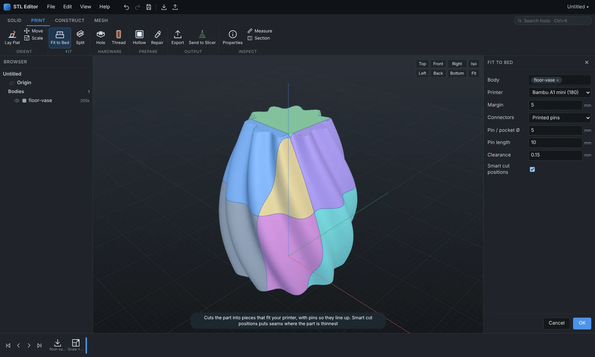
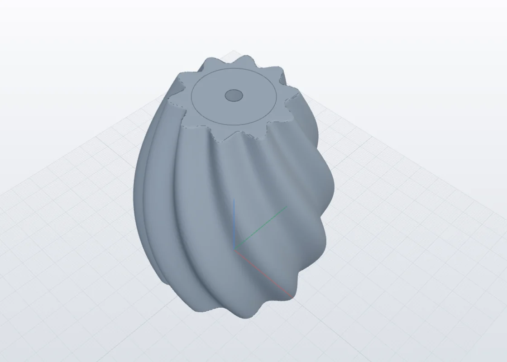
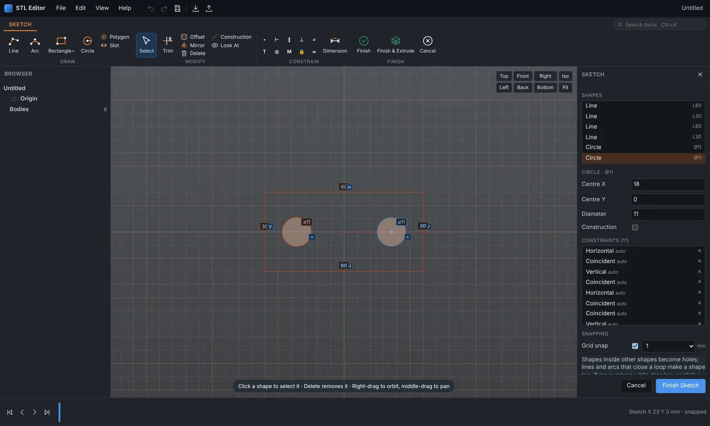
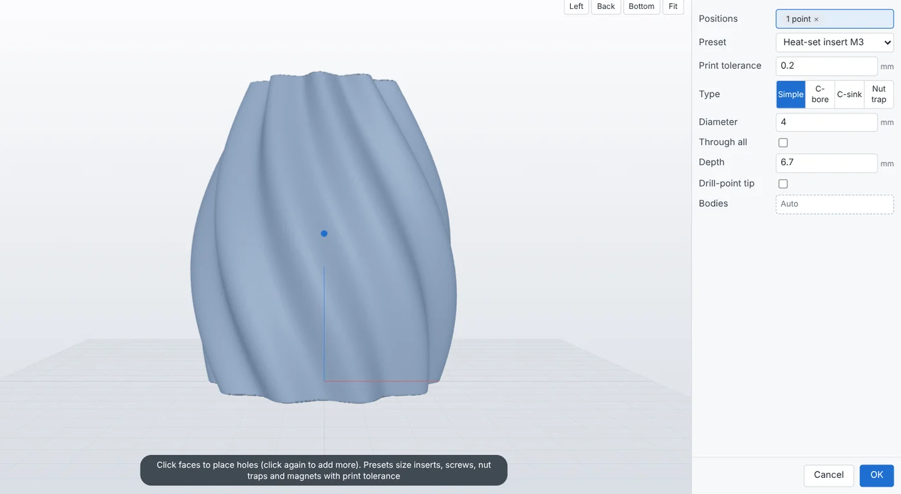
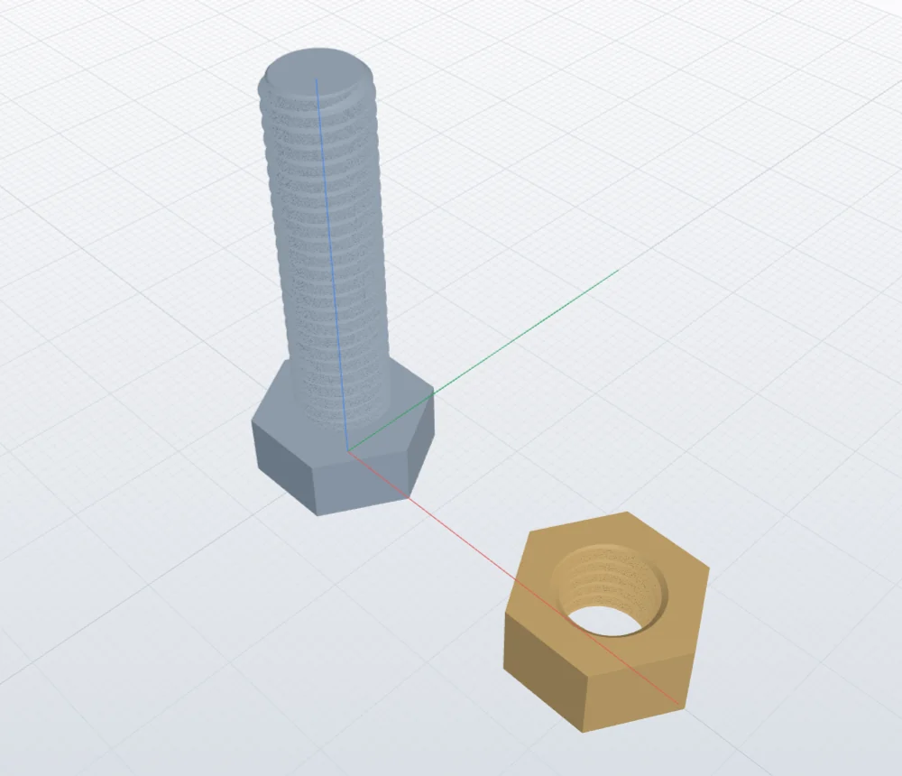
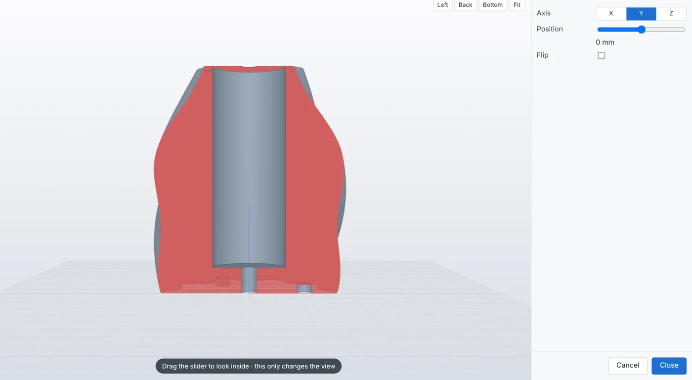
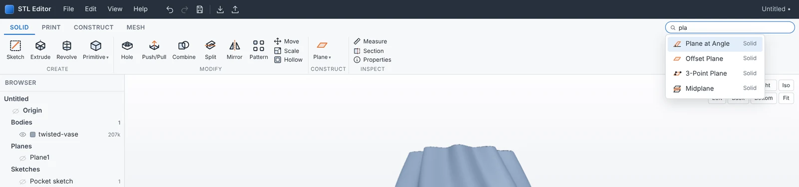

<div align="center">


# STL Editor

**CAD-style editing for STL files.**
Sketch on any face, extrude, cut, drill holes, add printable threads and split big parts to fit your printer. The meshes you download from Printables, Thingiverse or MakerWorld become editable solids.

[**Download for Windows**](https://github.com/natterman12/STL-Editor/releases/latest/download/STL-Editor-Windows-portable.zip) ·
[Project website](https://natterman12.github.io/STL-Editor/) ·
[User guide](USER_GUIDE.md) ·
[Releases](https://github.com/natterman12/STL-Editor/releases)




</div>

---

## Why

Most CAD programs treat STL files as dead geometry. You can look at them but you can't really change them. Mesh tools such as Meshmixer let you sculpt and patch, but they don't let you sketch a rectangle on a face and cut a 4 mm pocket.

STL Editor sits in between. It loads a mesh, makes sure it's a clean watertight solid, and lets you work on it with real CAD tools:

- **sketches** with constraints and dimensions
- **extrude / revolve / cut**
- **holes** with presets for inserts, screws, nuts and magnets
- **threads** that actually print
- **booleans**, **mirror**, **pattern**, **split**, **hollow**

Every step goes into a **timeline**. Double-click an earlier step to change it and everything after it updates. Nothing is baked in until you export.

## What it does

| | |
|---|---|
|  | **Edit downloaded models.** This vase came in as a 200k-triangle STL. A sketched circle cut the planter pocket, then a drain hole and three magnet pockets went into the base, giving four timeline steps that all stay editable. |
|  | **Real sketches.** Lines, arcs, rectangles, circles, polygons and slots. Constraints include coincident, horizontal/vertical, parallel, perpendicular, equal, tangent, concentric, midpoint, symmetric and fix, plus driving dimensions. Change a number and the shape follows. Trim, offset and mirror are included. |
|  | **Holes for real hardware.** Presets for heat-set inserts M2–M5, screw clearance, socket-head counterbores, hex nut traps and magnet pockets, all with a print tolerance. Click as many points as you like. |
|  | **Printable threads.** Tapped holes or bolts/studs, ISO metric M3–M30 or any size, right or left hand, chamfered ends and a print clearance. An M8 bolt and nut made with the defaults screw together. |
|  | **See inside.** Section view on X, Y or Z, plus measure and properties: size, volume, triangle count and print weight. |
|  | **A toolbar that stays out of the way.** Four tabs: Solid, Print, Construct and Mesh. Press `Ctrl+K` to find any tool by name. The toolbar shrinks to fit narrow windows instead of scrolling. |

### All tools

- **Create:** Sketch · Extrude (new / join / cut / intersect, one side / two sides / symmetric, through all, taper) · Revolve · Box · Cylinder · Sphere · Cone · Torus
- **Modify:** Hole · Thread · Push/Pull · Combine · Split (with connectors) · Mirror (bodies *or* features) · Pattern (linear / circular, bodies or features) · Move/Rotate · Scale · Hollow
- **Print:**
  - Lay Flat: click a face, or let it pick the most stable side.
  - Fit to Bed: pick your printer and big parts are cut into pieces that fit, with pins, pin holes, filament-pin holes or magnet pockets at every seam. *Smart cut positions* put the seams where the part is thinnest.
  - Export STL / 3MF / OBJ and Send to Bambu Studio / OrcaSlicer.
- **Construct:** Offset Plane · Plane at Angle · 3-Point Plane · Midplane. Any flat face works as a plane too.
- **Mesh:** Repair (quick fix, or rebuild as one watertight solid) · Simplify · Remesh · Sculpt brushes (smooth / flatten / inflate / deflate) · Separate · To STEP (through SolidCraft)
- **Everything else:** undo/redo · `.stlx` projects that keep the whole timeline · inch mode with fractions (`1 3/8`) · light and dark themes · autosave with crash recovery · update notice

## Install

1. Download **[STL-Editor-Windows-portable.zip](https://github.com/natterman12/STL-Editor/releases/latest/download/STL-Editor-Windows-portable.zip)** (about 90 MB).
2. Unzip it anywhere (Desktop, Documents, a USB stick) and run **STL Editor.exe**.
3. The app isn't code-signed yet, so Windows SmartScreen may say *"Windows protected your PC"*. Click **More info › Run anyway**.

Nothing gets installed and no admin rights are needed. Settings live in `%APPDATA%\STL Editor`. When a new release is posted here, the app shows a small notice with a download button.

### Quick start

1. Drag an STL onto the window.
2. Double-click a flat face to sketch on it, and draw a rectangle or circle (type numbers while drawing for exact sizes).
3. Click **Finish & Extrude**, choose **Cut**, set the depth and press **OK**.
4. **File › Export STL / 3MF**, or **Send to Slicer**.

The full manual, with every tool and shortcut, is in [USER_GUIDE.md](USER_GUIDE.md).

## Run from source

You need Python 3.11 or newer on Windows (tested with 3.13 and 3.14). The WebView2 runtime is already part of Windows 10/11.

```powershell
git clone https://github.com/natterman12/STL-Editor.git
cd STL-Editor
pip install -r requirements.txt
python main.py                      # desktop window
python main.py --browser            # or open it in your browser instead
```

`install.ps1` adds Start Menu and Desktop shortcuts, opens `.stlx` files with STL Editor, and adds *Edit in STL Editor* to the right-click menu of `.stl`, `.3mf` and `.obj` files (current user only).

The engine and the browser UI aren't tied to Windows: `python main.py --browser` should work on macOS and Linux too. Only Windows is tested so far. Reports and fixes are welcome.

### Build the portable zip

```powershell
pip install pyinstaller
powershell -ExecutionPolicy Bypass -File packaging\build_portable.ps1 -Repo natterman12/STL-Editor
```

The zip lands in `Documents\STL Editor - Share\`.

## How it works

```
 main.py ──► local engine (Python, 127.0.0.1 only) ◄──JSON/binary──► UI (three.js in a WebView2 window)
              │
              ├─ document.py   feature timeline, cached re-evaluation, undo/redo, .stlx projects
              ├─ features.py   every tool as a function of (state, parameters)
              ├─ geometry.py   mesh I/O, repair, voxel rebuild, hollow
              ├─ sketch.py     sketch entities → regions (Shapely)
              └─ printing.py   fit-to-bed, connectors, threads, lay flat, sculpt, remesh
```

- **Booleans:** [Manifold](https://github.com/elalish/manifold) gives exact, watertight results fast, even on meshes with hundreds of thousands of triangles.
- **Repair and voxel work:** trimesh, scikit-image and SciPy.
- **Sketch constraints:** solved in the browser with a small Gauss-Newton solver (`web/js/constraints.js`).
- **Privacy:** nothing leaves your computer. The only network request is an optional check of this repository's *latest release* page.

## Limits

- STL files have no real edges, so **fillet and chamfer on mesh edges aren't available**. For blocky mechanical parts, *To STEP* hands the mesh to SolidCraft.
- Bodies that aren't watertight show and export fine, but need **Repair** before you can edit them.
- Hollow and *Repair › Rebuild* use a voxel grid. Pick *Quality › Fine* for small details.

## Contributing

Bug reports, ideas and pull requests are welcome. [Open an issue](https://github.com/natterman12/STL-Editor/issues) with the STL, if you can share it, and the steps that went wrong. Ideas already on the list: text and logo emboss, colour 3MF for the AMS, wall-thickness and overhang checks, a move gizmo and plate layout.

## Licence

STL Editor is free software under the **GNU General Public License v3.0**. See [LICENSE](LICENSE). You can use, study, change and share it. If you distribute a modified version, it must stay under the GPL with its source available.

It's built on open-source libraries, whose licence texts ship in the `LICENSES` folder of every release:
[manifold3d](https://github.com/elalish/manifold) (Apache-2.0) ·
[three.js](https://threejs.org) (MIT) ·
[three-mesh-bvh](https://github.com/gkjohnson/three-mesh-bvh) (MIT) ·
[trimesh](https://trimesh.org) (MIT) ·
[Shapely](https://shapely.readthedocs.io) (BSD-3) ·
[scikit-image](https://scikit-image.org) (BSD-3) ·
[SciPy](https://scipy.org) / [NumPy](https://numpy.org) (BSD-3) ·
[fast-simplification](https://github.com/pyvista/fast-simplification) (MIT) ·
[pywebview](https://pywebview.flowrl.com) (BSD-3)
