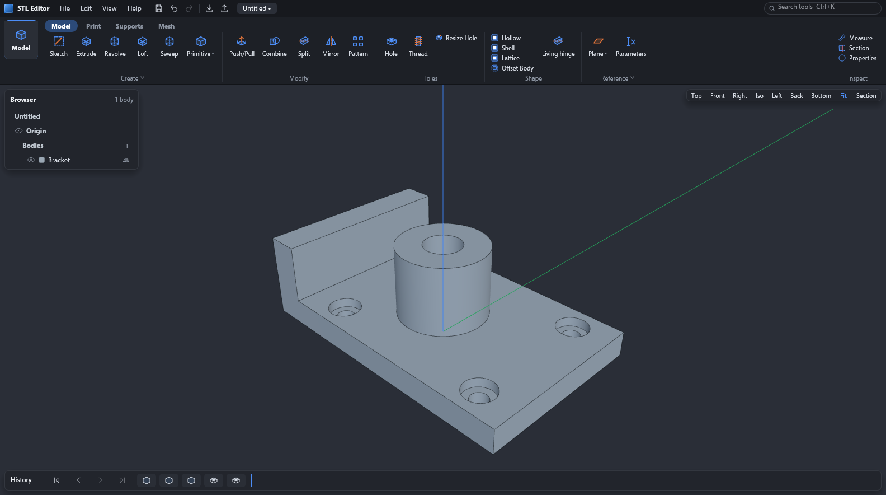
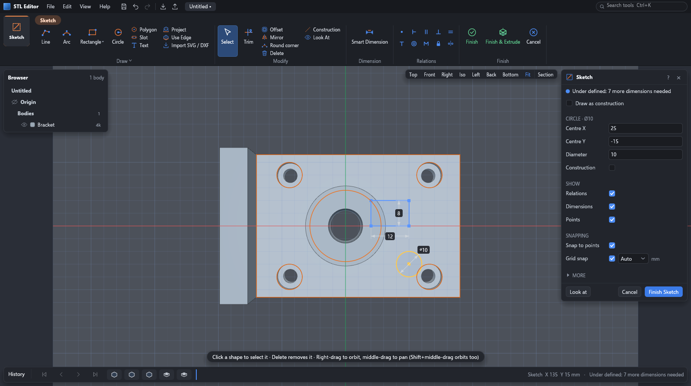
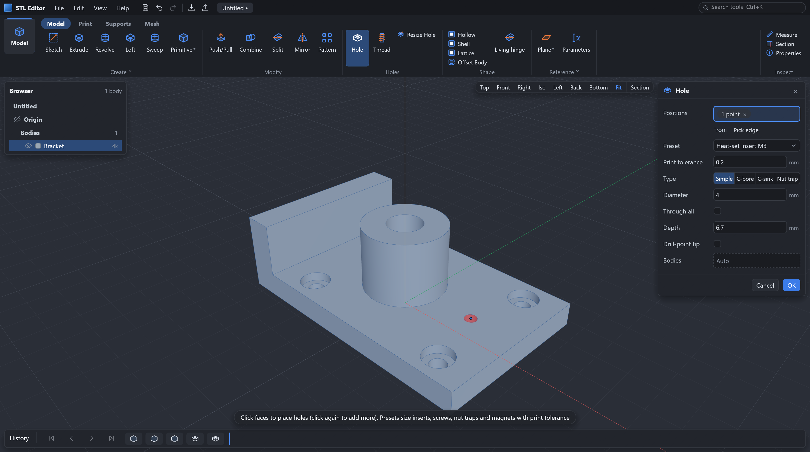
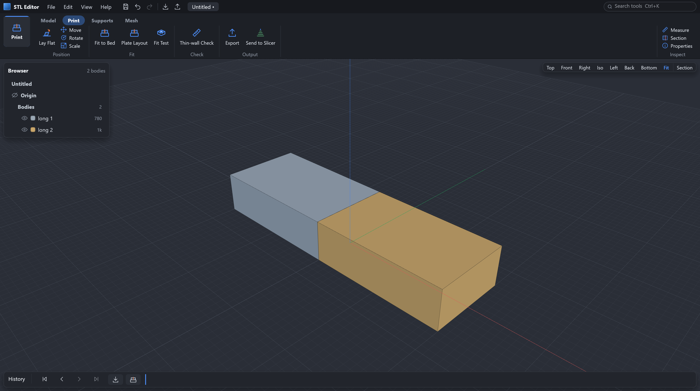
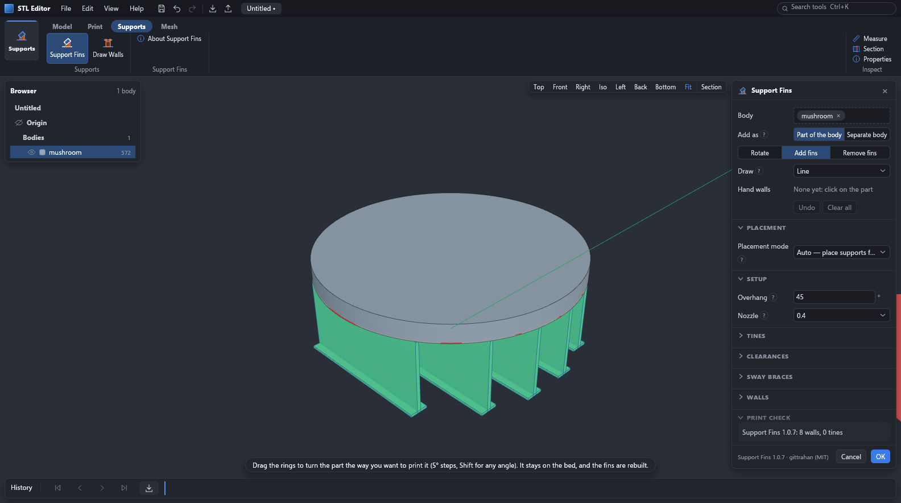
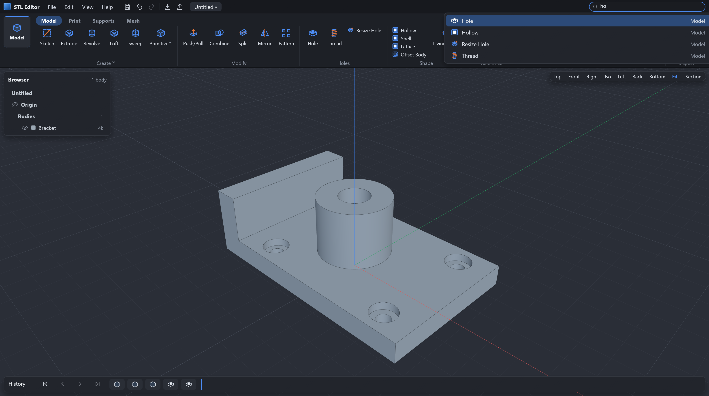

<div align="center">


# STL Editor

**CAD-style editing for STL files.**
Sketch on any face, extrude, cut, drill holes, add printable threads and split big parts to fit your printer. The meshes you download from Printables, Thingiverse or MakerWorld become editable solids.

**New in 2.0:** STL Editor has been rebuilt from the ground up in Rust. It's one small program with nothing else to install, it starts fast and stays smooth on big meshes, and the same app runs on Windows, Mac, Linux and in your browser. Your 1.x projects open as they are. [What's new](#whats-new-in-20)

[**Download for Windows**](https://github.com/natterman12/STL-Editor/releases/latest/download/STL-Editor-2-Windows.exe) ·
[**Open the web app**](https://natterman12.github.io/STL-Editor/app/) ·
[Project website](https://natterman12.github.io/STL-Editor/) ·
[User guide](USER_GUIDE.md) ·
[Releases](https://github.com/natterman12/STL-Editor/releases)


[](https://natterman12.github.io/STL-Editor/app/)

[](https://ko-fi.com/natterman12)
[](https://github.com/natterman12/STL-Editor/actions/workflows/rust.yml)



</div>

---

## Why

Most CAD programs treat STL files as dead geometry. You can look at them but you can't really change them. Mesh tools such as Meshmixer let you sculpt and patch, but they don't let you sketch a rectangle on a face and cut a 4 mm pocket.

STL Editor sits in between. It loads a mesh, makes sure it's a clean watertight solid, and lets you work on it with real CAD tools:

- **sketches** with constraints and dimensions
- **extrude / revolve / cut**
- **holes** with presets for inserts, screws, nuts and magnets
- **threads** that actually print
- **booleans**, **mirror**, **pattern**, **split**, **hollow**, **loft**, **sweep**, **lattice**

Every step goes into a **timeline**. Double-click an earlier step to change it and everything after it updates. Nothing is baked in until you export.

The interface keeps your focus on the model: the part fills the window, with a floating Browser panel, a History bar along the bottom, and tool search at the top right.

## What's new in 2.0

2.0 does everything 1.x does, with the same tabs, panels and shortcuts, so there's nothing to relearn. What changed is underneath:

- **One small program.** The Windows download is a single `.exe` with no Python, no zip to unpack and nothing to install. Settings live in their own folder, so 1.x and 2.0 can sit side by side while you switch.
- **Much faster.** On the same test parts, Hollow went from 57 s to 1.4 s, Repair › Rebuild from 11.3 s to 1.3 s, Remesh from 10 s to 2.4 s and opening a file from 1.6 s to 0.6 s. No tool is slower than in 1.x, and the 3D view draws on your graphics card, so big meshes stay smooth.
- **The same app everywhere.** Windows, Mac, Linux and the web edition are now built from the same code, so they look and behave the same.
- **Your projects come with you.** `.stlx` projects from 1.x open and rebuild in 2.0.
- **Better Section and Split.** Pick any plane or flat face, then drag an arrow (or type a distance) to move the cut. Section View draws the cut faces with hatch lines so they're easy to tell apart.

## What it does

| | |
|---|---|
|  | **Real sketches.** Double-click any flat face to sketch lines, arcs, rectangles, circles, polygons and slots. Constraints include coincident, horizontal/vertical, parallel, perpendicular, equal, tangent, concentric, midpoint, symmetric and fix, plus Smart Dimension: dimensions drawn on the sketch with arrows, measured from the sketch or from the part's own edges, black when fully defined and blue while shapes can still move. Change a number (or a parameter) and the shape follows. Trim, offset, use edge and mirror are included. |
|  | **Holes and printable threads.** Presets for heat-set inserts M2–M5, screw clearance, socket-head counterbores, hex nut traps and magnet pockets, all with a print tolerance. Make tapped holes or bolts/studs in ISO metric M1.6–M30, UNC and UNF inch sizes, or custom sizes, right or left hand, with chamfered ends and print clearance so printed threads screw together. Resize Hole measures any round hole or pin and changes its diameter (or fills it). |
|  | **Too big for your bed? Split it.** Pick your printer or bed size and large models are cut into pieces that fit. Alignment pins, pin holes, filament dowels or magnet pockets are added automatically at every seam so the pieces line up when you glue them. Smart cut positions put seams where the part is thinnest. |
|  | **Supports that snap off.** Built-in Support Fins adds breakaway support walls and a bed pad to the mesh; they snap off by hand. Overhang coverage checks highlight unreached areas in bright red, orientation advice ranks print angles for strength and minimal support, the support plastic is shown in grams, and Draw Walls lets you place custom support walls right where needed. |
|  | **Find any tool fast.** Tools sit on four tabs: Model, Print, Supports and Mesh, with Inspect on every tab. Press `Ctrl+K` (or `/`) to find any tool by name. The compact toolbar shrinks to fit narrow windows instead of scrolling. |

### All tools

- **MODEL:**
  - **Create:** Sketch · Extrude (new / join / cut / intersect, one side / two sides / symmetric, through all, taper) · Revolve · Loft (blend between two or more sketches) · Sweep (run a profile along a path) · Primitive (Box, Cylinder, Sphere, Cone, Torus)
  - **Modify:** Push/Pull · Combine (cut with clearance) · Split (with connectors; drag the cut plane to where you want it) · Mirror (bodies *or* features) · Pattern (linear / circular, bodies or features)
  - **Holes:** Hole (presets for heat-set inserts, counterbores, hex nuts, magnet pockets) · Thread (metric and inch (UNC/UNF) tapped holes or bolts/studs, right or left hand, with print clearance) · Resize Hole (measure and change, or fill, any round hole or pin)
  - **Shape:** Hollow · Shell (hollow with up to 4 flat faces left open, like a box or cup) · Lattice (hollow it and fill the inside with thin struts: light but stiff) · Offset Body (grow or shrink a whole part) · Living hinge (a slot across a block that leaves a thin strip that bends)
  - **Reference:** Plane (Offset Plane, Plane at Angle, 3-Point Plane, Midplane; any flat face works as a plane too) · Parameters (name values like `width = 40`, `height = width/4 + 5` and use them in any number; change one and the whole timeline rebuilds)
- **PRINT:**
  - **Position:** Lay Flat (click a face, or let it pick the most stable side) · Move · Rotate · Scale (with on-part handles; rotated parts land on the bed)
  - **Fit:** Fit to Bed (pick your printer and big parts are cut into pieces that fit, with pins, pin holes, filament dowels or magnet pockets at every seam; smart cut positions put seams where the part is thinnest) · Plate Layout (sets the parts side by side on the bed) · Fit Test (a plate of pegs and holes that shows which clearance your printer needs)
  - **Check:** Thin-wall Check (shows walls too thin to print well)
  - **Output:** Export (STL / 3MF / OBJ) · Send to Slicer *(desktop only)* (Bambu Studio, OrcaSlicer, PrusaSlicer)
- **SUPPORTS:**
  - **Support Fins** ([Support Fins](https://github.com/gittrahan/support-fins) by gittrahan, built in): tip a part to its strong print orientation and add the breakaway fins and bed pad that hold up its overhangs, baked into the mesh. Every Support Fins setting is there (placement, tines, nozzle, sway braces for tall parts, cutouts...), plus orientation ranking, strength checks, support plastic shown in grams, and bright red overhang coverage checks. New Support Fins releases reach both editions automatically.
  - **Draw Walls:** place custom support walls by hand (straight, multi-section, curved, gussets off a side and anchor fins).
  - **About Support Fins:** which version is built in, and where it comes from.
- **MESH:** Repair (quick fix, or rebuild as one watertight solid) · Simplify · Remesh · Separate · Remove Bodies · Brushes (smooth / flatten / inflate / deflate) · To STEP *(Windows desktop only)*
- **INSPECT** *(on every tab)*: Measure · Section (cut the view open on X, Y, Z, any plane or a flat face, drag it into place, with hatched cut faces; stays on while you work, X turns it off and on) · Properties (size, volume, triangle count and print weight)
- **SKETCH:** Line · Arc · Rectangle · Center Rectangle · Circle · Polygon · Slot · Text (any installed font) · Project (section or silhouette of the model, with offset) · Use Edge · Import SVG / DXF · Select · Trim · Offset · Mirror · Round corner · Delete · Smart Dimension (length, diameter, radius, distance, angle; to part edges; reference dimensions; parameters) · Construction · Look At · 11 relations (coincident, horizontal/vertical, parallel, perpendicular, equal, tangent, concentric, midpoint, symmetric, fix)
- **Everything else:** undo/redo · `.stlx` projects that keep the whole timeline (1.x projects open too) · inch mode with fractions (`1 3/8`) · light and dark themes · autosave with crash recovery · one-click updates

## Install

1. Download **[STL-Editor-2-Windows.exe](https://github.com/natterman12/STL-Editor/releases/latest/download/STL-Editor-2-Windows.exe)**.
2. Put it anywhere (Desktop, Documents, a USB stick) and double-click it. That's it: it's one file.
3. The app isn't code-signed yet, so Windows SmartScreen may say *"Windows protected your PC"*. Click **More info › Run anyway**.

**Mac and Linux (beta):** get **STL-Editor-2-macOS.app.zip** or **STL-Editor-2-x86_64.AppImage** from the [Releases page](https://github.com/natterman12/STL-Editor/releases). They're the same app as on Windows, but newer and less tested. The Mac app isn't signed yet, so the first time, right-click it and choose **Open**. If something goes wrong, the web edition is the safe choice.

Nothing gets installed and no admin rights are needed. Settings live in `%APPDATA%\STL Editor 2`, apart from 1.x's, so you can keep both. When a new release is posted, the app shows a notice; click **Update now** and it downloads the new version, checks it, swaps it in and restarts (or use Help › Check for Updates).

### Web edition

**[Open the web app](https://natterman12.github.io/STL-Editor/app/)**: nothing to download, works on Windows, macOS, Linux, ChromeOS and tablets in a recent Chrome, Edge, Firefox or Safari. It's the same app as the desktop one, compiled to WebAssembly, with the same `.stlx` project files. Everything runs inside the page, so your models never leave your computer.

Every modelling tool works in the browser, including Hollow, Remesh, Brushes and *Repair › Rebuild*. It keeps autosave copies for recovery and a recent-files list, saves straight back to the project you opened (Chrome and Edge), works offline after the first visit, and can be installed as an app that opens `.stlx` and mesh files. Only Send to Slicer and To STEP need the desktop app, because they start programs on your computer. The desktop app is also faster on very large meshes.

### Quick start

1. Drag an STL onto the window.
2. Double-click a flat face to sketch on it, and draw a rectangle or circle (type numbers while drawing for exact sizes).
3. Click **Finish & Extrude**, choose **Cut**, set the depth and press **OK**.
4. **File › Export STL / 3MF**, or **Send to Slicer**.

The full manual, with every tool and shortcut, is in [USER_GUIDE.md](USER_GUIDE.md).

## Run from source

2.0 is written in Rust and lives in the `rust/` folder. Install Rust from [rustup.rs](https://rustup.rs) (the right version is picked for you from `rust/rust-toolchain.toml`), then:

```powershell
git clone https://github.com/natterman12/STL-Editor.git
cd STL-Editor/rust
cargo run --release -p stl-app           # the desktop app
cargo run -p xtask -- web --serve        # the web edition on localhost
cargo nextest run --workspace --release  # the tests (or cargo test)
```

On Linux you also need the usual windowing packages (`libxkbcommon-dev`, `libwayland-dev`, `libx11-dev`). Every push builds the Windows `.exe`, the Mac app, the Linux AppImage and the web edition on GitHub Actions.

The 1.x app (Python and JavaScript) is still in the repository (`stleditor/`, `web/`, `main.py`) while 2.0 settles in. [CONTRIBUTING.md](CONTRIBUTING.md) covers it.

## How it works

```
 stl-app (egui window, wgpu 3D view; desktop and WebAssembly)
   │
   ├─ stl-engine     feature timeline, cached re-evaluation, undo/redo, parameters, .stlx projects
   ├─ stl-sketch     sketches, constraints and dimensions, text, SVG / DXF import
   ├─ stl-mesh       repair, simplify, remesh, voxel work, sculpt brushes
   ├─ stl-io         STL, 3MF, OBJ, PLY, OFF, GLB in; STL, 3MF, OBJ, STEP out
   ├─ stl-platform   desktop only: settings, autosave, updates, slicer and STEP hand-off
   └─ stl-kernel     solids and 2D shapes on manifold-rust
```

- **Booleans:** [manifold-rust](https://github.com/natterman12/manifold-rust), a Rust port of [Manifold](https://github.com/elalish/manifold), gives exact, watertight results fast, even on meshes with hundreds of thousands of triangles.
- **Pure Rust:** no C or C++ in the app or its geometry, file and network code, which keeps the download small and lets the same code build for every platform and the browser.
- **Interface:** [egui](https://github.com/emilk/egui) draws the window and [wgpu](https://wgpu.rs) the 3D view (DirectX 12, Metal, Vulkan, or WebGPU / WebGL2 in the browser).
- **Support Fins:** its own engine is bundled unchanged and runs inside the app ([Boa](https://boajs.dev) on the desktop, the browser's JavaScript on the web), so new Support Fins releases reach both.
- **Privacy:** nothing leaves your computer. The only network request is an optional check of this repository's releases page for a new version.

## Limits

- STL files have no real edges, so **fillet and chamfer on mesh edges aren't available**. For blocky mechanical parts, *To STEP* turns the mesh into a STEP file for your CAD program.
- Bodies that aren't watertight show and export fine, but need **Repair** before you can edit them.
- Hollow and *Repair › Rebuild* use a voxel grid. Pick *Quality › Fine* for small details.
- Snap-fit from 1.x isn't offered in 2.0. Projects that already have a Snap-fit step still open and rebuild.

## Contributing

Bug reports, ideas and pull requests are welcome. [Open an issue](https://github.com/natterman12/STL-Editor/issues/new/choose): the forms ask for the model file and steps, which makes mesh bugs much faster to fix. [CONTRIBUTING.md](CONTRIBUTING.md) covers setup, the code layout, how to add a tool and how releases are made. Tests run on GitHub for every push and pull request. Ideas already on the list: fillet and chamfer on mesh edges, sketch splines and ellipses, and colour 3MF for the AMS.

## Support the project

STL Editor is free, with no ads and no account, and it stays that way. I build it in my spare time. If it saved you a reprint or an evening in CAD, you can [buy me a coffee on Ko-fi](https://ko-fi.com/natterman12) ♥. Bug reports, ideas and telling a friend about it help just as much.

## Licence

STL Editor is free software under the **GNU General Public License v3.0**. See [LICENSE](LICENSE). You can use, study, change and share it. If you distribute a modified version, it must stay under the GPL with its source available.

It's built on open-source libraries, among them:
[manifold-rust](https://github.com/natterman12/manifold-rust) and [Manifold](https://github.com/elalish/manifold) (Apache-2.0) ·
[egui / eframe](https://github.com/emilk/egui) (MIT / Apache-2.0) ·
[wgpu](https://wgpu.rs) (MIT / Apache-2.0) ·
[Boa](https://boajs.dev) (MIT) ·
[resvg](https://github.com/linebender/resvg) (Apache-2.0 / MIT) ·
[rfd](https://github.com/PolyMeilex/rfd) (MIT) ·
[Rayon](https://github.com/rayon-rs/rayon) (MIT / Apache-2.0) ·
[Support Fins](https://github.com/gittrahan/support-fins) (MIT)
