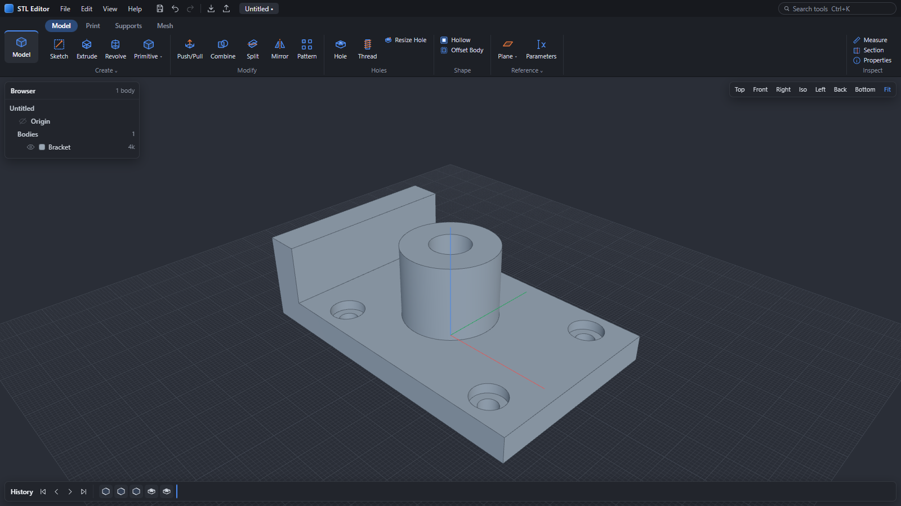
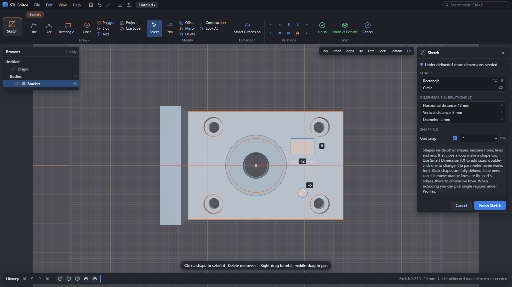
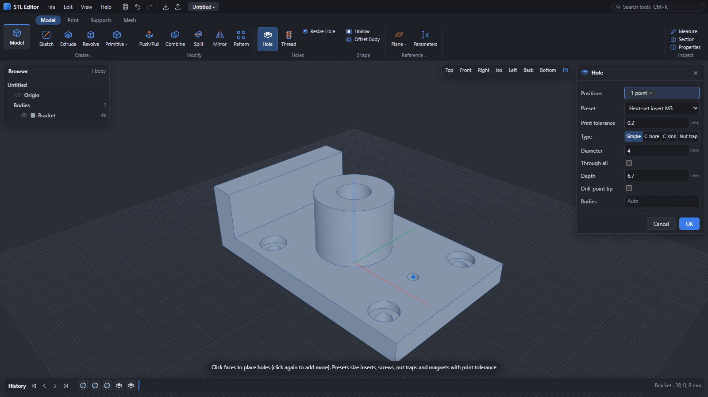
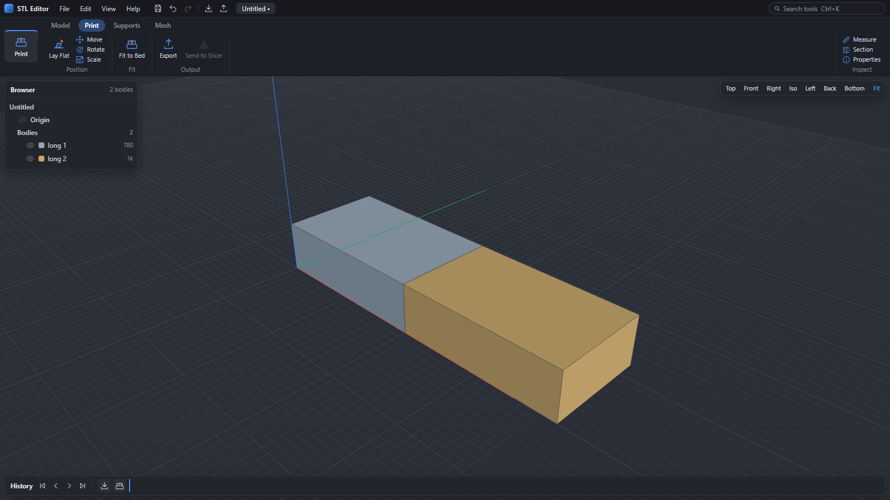
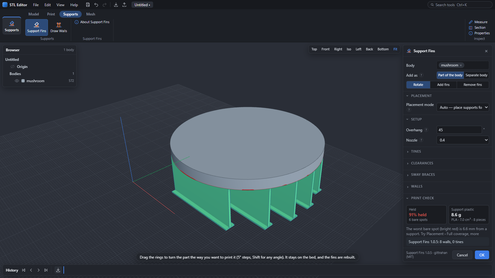
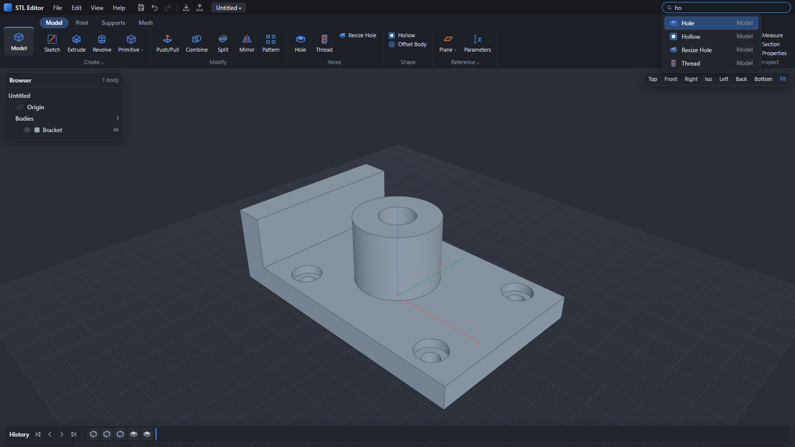

<div align="center">


# STL Editor

**CAD-style editing for STL files.**
Sketch on any face, extrude, cut, drill holes, add printable threads and split big parts to fit your printer. The meshes you download from Printables, Thingiverse or MakerWorld become editable solids.

[**Download for Windows**](https://github.com/natterman12/STL-Editor/releases/latest/download/STL-Editor-Windows-portable.zip) ·
[**Open the web app**](https://natterman12.github.io/STL-Editor/app/) ·
[Project website](https://natterman12.github.io/STL-Editor/) ·
[User guide](USER_GUIDE.md) ·
[Releases](https://github.com/natterman12/STL-Editor/releases)


[](https://natterman12.github.io/STL-Editor/app/)

[](https://ko-fi.com/natterman12)
[](https://github.com/natterman12/STL-Editor/actions/workflows/tests.yml)



</div>

---

## Why

Most CAD programs treat STL files as dead geometry. You can look at them but you can't really change them. Mesh tools such as Meshmixer let you sculpt and patch, but they don't let you sketch a rectangle on a face and cut a 4 mm pocket.

STL Editor sits in between. It loads a mesh, makes sure it's a clean watertight solid, and lets you work on it with real CAD tools:

- **sketches** with constraints and dimensions
- **extrude / revolve / cut**
- **holes** with presets for inserts, screws, nuts and magnets
- **threads** that actually print
- **booleans**, **mirror**, **pattern**, **split**, **hollow**

Every step goes into a **timeline**. Double-click an earlier step to change it and everything after it updates. Nothing is baked in until you export.

The interface keeps your focus on the model: the part fills the window, with a floating Browser panel, a History bar along the bottom, and tool search at the top right.

## What it does

| | |
|---|---|
|  | **Real sketches.** Double-click any flat face to sketch lines, arcs, rectangles, circles, polygons and slots. Constraints include coincident, horizontal/vertical, parallel, perpendicular, equal, tangent, concentric, midpoint, symmetric and fix, plus Smart Dimension: dimensions drawn on the sketch with arrows, measured from the sketch or from the part's own edges, black when fully defined and blue while shapes can still move. Change a number (or a parameter) and the shape follows. Trim, offset, use edge and mirror are included. |
|  | **Holes and printable threads.** Presets for heat-set inserts M2–M5, screw clearance, socket-head counterbores, hex nut traps and magnet pockets, all with a print tolerance. Make tapped holes or bolts/studs in ISO metric M1.6–M30, UNC and UNF inch sizes, or custom sizes, right or left hand, with chamfered ends and print clearance so printed threads screw together. Resize Hole measures any round hole or pin and changes its diameter (or fills it). |
|  | **Too big for your bed? Split it.** Pick your printer or bed size and large models are cut into pieces that fit. Alignment pins, pin holes, filament dowels or magnet pockets are added automatically at every seam so the pieces line up when you glue them. Smart cut positions put seams where the part is thinnest. |
|  | **Supports that snap off.** Built-in Support Fins adds breakaway support walls and a bed pad to the mesh; they snap off by hand. Overhang coverage checks highlight unreached areas in bright red, orientation advice ranks print angles for strength and minimal support, the support plastic is shown in grams, and Draw Walls lets you place custom support walls right where needed. |
|  | **Find any tool fast.** Tools sit on four tabs: Model, Print, Supports and Mesh, with Inspect on every tab. Press `Ctrl+K` (or `/`) to find any tool by name. The compact toolbar shrinks to fit narrow windows instead of scrolling. |

### All tools

- **MODEL:**
  - **Create:** Sketch · Extrude (new / join / cut / intersect, one side / two sides / symmetric, through all, taper) · Revolve · Primitive (Box, Cylinder, Sphere, Cone, Torus)
  - **Modify:** Push/Pull · Combine (cut with clearance) · Split (with connectors) · Mirror (bodies *or* features) · Pattern (linear / circular, bodies or features)
  - **Holes:** Hole (presets for heat-set inserts, counterbores, hex nuts, magnet pockets) · Thread (metric and inch (UNC/UNF) tapped holes or bolts/studs, right or left hand, with print clearance) · Resize Hole (measure and change, or fill, any round hole or pin)
  - **Shape:** Hollow · Offset Body (grow or shrink a whole part)
  - **Reference:** Plane (Offset Plane, Plane at Angle, 3-Point Plane, Midplane; any flat face works as a plane too) · Parameters (name values like `width = 40`, `height = width/4 + 5` and use them in any number; change one and the whole timeline rebuilds)
- **PRINT:** Lay Flat (click a face, or let it pick the most stable side) · Move · Rotate · Scale (with on-part handles; rotated parts land on the bed) · Fit to Bed (pick your printer and big parts are cut into pieces that fit, with pins, pin holes, filament dowels or magnet pockets at every seam; smart cut positions put seams where the part is thinnest) · Export (STL / 3MF / OBJ) · Send to Slicer *(desktop only)* (Bambu Studio / OrcaSlicer)
- **SUPPORTS:**
  - **Support Fins** ([Support Fins](https://github.com/gittrahan/support-fins) by gittrahan, built in): tip a part to its strong print orientation and add the breakaway fins and bed pad that hold up its overhangs, baked into the mesh. Every Support Fins setting is there (placement, tines, nozzle, sway braces for tall parts, cutouts...), plus orientation ranking, strength checks, support plastic shown in grams, and bright red overhang coverage checks. New Support Fins releases reach both editions automatically.
  - **Draw Walls:** place custom support walls by hand (straight, multi-section, curved, gussets off a side and anchor fins).
- **MESH:** Repair (quick fix, or rebuild as one watertight solid) · Simplify · Remesh · Separate · Remove Bodies · Brushes (smooth / flatten / inflate / deflate) · To STEP *(desktop only)* (through SolidCraft)
- **INSPECT** *(on every tab)*: Measure · Section (view on X, Y or Z) · Properties (size, volume, triangle count and print weight)
- **SKETCH:** Line · Arc · Rectangle · Center Rectangle · Circle · Polygon · Slot · Text (any installed font) · Project (section or silhouette of the model, with offset) · Use Edge · Trim · Offset · Mirror · Smart Dimension (length, diameter, radius, distance, angle; to part edges; reference dimensions; parameters) · Construction · Look At · 11 relations (coincident, horizontal/vertical, parallel, perpendicular, equal, tangent, concentric, midpoint, symmetric, fix)
- **Everything else:** undo/redo · `.stlx` projects that keep the whole timeline · inch mode with fractions (`1 3/8`) · light and dark themes · autosave with crash recovery · one-click updates

## Install

1. Download **[STL-Editor-Windows-portable.zip](https://github.com/natterman12/STL-Editor/releases/latest/download/STL-Editor-Windows-portable.zip)** (about 79 MB).
2. Unzip it anywhere (Desktop, Documents, a USB stick) and run **STL Editor.exe**.
3. The app isn't code-signed yet, so Windows SmartScreen may say *"Windows protected your PC"*. Click **More info › Run anyway**.

Nothing gets installed and no admin rights are needed. Settings live in `%APPDATA%\STL Editor`. When a new release is posted, the app shows a notice; click **Update now** and it downloads the release, checks its SHA-256, swaps in the new version and restarts (or use Help › Check for Updates).

### Web edition

**[Open the web app](https://natterman12.github.io/STL-Editor/app/)**: nothing to download, works on Windows, macOS, Linux, ChromeOS and tablets in a recent Chrome, Edge, Firefox or Safari. It's the same interface and the same `.stlx` project files. The geometry engine (Manifold compiled to WebAssembly) runs inside the page, so your models never leave your computer.

Every modelling tool works in the browser, including Hollow, Remesh, Brushes and *Repair › Rebuild*. It keeps autosave copies for recovery and a recent-files list, saves straight back to the project you opened (Chrome and Edge), works offline after the first visit, and can be installed as an app that opens `.stlx` and mesh files. Only Send to Slicer and To STEP need the desktop app, because they start programs on your computer. The desktop app is also faster on very large meshes and allows finer voxel settings.

### Quick start

1. Drag an STL onto the window.
2. Double-click a flat face to sketch on it, and draw a rectangle or circle (type numbers while drawing for exact sizes).
3. Click **Finish & Extrude**, choose **Cut**, set the depth and press **OK**.
4. **File › Export STL / 3MF**, or **Send to Slicer**.

The full manual, with every tool and shortcut, is in [USER_GUIDE.md](USER_GUIDE.md).

## Run from source

You need Python 3.12 or newer on Windows (tested with 3.12, 3.13 and 3.14). The WebView2 runtime is already part of Windows 10/11.

```powershell
git clone https://github.com/natterman12/STL-Editor.git
cd STL-Editor
pip install -r requirements.txt
python main.py                      # desktop window
python main.py --browser            # or open it in your browser instead
```

`install.ps1` adds Start Menu and Desktop shortcuts, opens `.stlx` files with STL Editor, and adds *Edit in STL Editor* to the right-click menu of `.stl`, `.3mf` and `.obj` files (current user only).

The engine and the browser UI aren't tied to Windows: `python main.py --browser` should work on macOS and Linux too. Only Windows is tested so far. Reports and fixes are welcome.

Run the tests with `pip install pytest` and then `python -m pytest -q tests`.

### Build the portable zip

GitHub Actions builds it for every release tag. To build it yourself:

```powershell
pip install pyinstaller
powershell -ExecutionPolicy Bypass -File packaging\build_portable.ps1 -Repo natterman12/STL-Editor
```

The zip lands in `Documents\STL Editor - Share\`.

## How it works

```
 main.py ──► local engine (Python, 127.0.0.1 only) ◄──JSON/binary──► UI (three.js in a WebView2 window)
              │
              ├─ document.py   feature timeline, cached re-evaluation, undo/redo, .stlx projects
              ├─ features.py   every tool as a function of (state, parameters)
              ├─ geometry.py   mesh I/O, repair, voxel rebuild, hollow
              ├─ sketch.py     sketch entities → regions (Shapely)
              └─ printing.py   fit-to-bed, connectors, threads, lay flat, sculpt, remesh
```

- **Booleans:** [Manifold](https://github.com/elalish/manifold) gives exact, watertight results fast, even on meshes with hundreds of thousands of triangles.
- **Repair and voxel work:** trimesh, scikit-image and SciPy.
- **Sketch constraints:** solved in the browser with a small Gauss-Newton solver (`web/js/constraints.js`), which also works out how defined the sketch is (the rank of its Jacobian); `web/js/dims.js` draws the dimensions.
- **Web edition:** the same UI runs the JavaScript engine in `web/engine/` in a Web Worker instead of the Python one. It answers the same API routes, uses [manifold-3d](https://www.npmjs.com/package/manifold-3d) (WebAssembly) for booleans, [fflate](https://github.com/101arrowz/fflate) for `.stlx` and 3MF and [opentype.js](https://opentype.js.org) for text. `packaging/build_web.py` publishes it to `docs/app/` for GitHub Pages.
- **Privacy:** nothing leaves your computer. The only network request is an optional check of this repository's *latest release* page.

## Limits

- STL files have no real edges, so **fillet and chamfer on mesh edges aren't available**. For blocky mechanical parts, *To STEP* hands the mesh to SolidCraft.
- Bodies that aren't watertight show and export fine, but need **Repair** before you can edit them.
- Hollow and *Repair › Rebuild* use a voxel grid. Pick *Quality › Fine* for small details.

## Contributing

Bug reports, ideas and pull requests are welcome. [Open an issue](https://github.com/natterman12/STL-Editor/issues/new/choose): the forms ask for the model file and steps, which makes mesh bugs much faster to fix. [CONTRIBUTING.md](CONTRIBUTING.md) covers setup, the code layout, how to add a tool and how releases are made. Tests run on GitHub for every push and pull request, and pushing a `v*` tag builds and publishes the portable zip automatically. Ideas already on the list: SVG/DXF import, colour 3MF for the AMS, wall-thickness and overhang checks, and plate layout.

## Support the project

STL Editor is free, with no ads and no account, and it stays that way. I build it in my spare time. If it saved you a reprint or an evening in CAD, you can [buy me a coffee on Ko-fi](https://ko-fi.com/natterman12) ♥. Bug reports, ideas and telling a friend about it help just as much.

## Licence

STL Editor is free software under the **GNU General Public License v3.0**. See [LICENSE](LICENSE). You can use, study, change and share it. If you distribute a modified version, it must stay under the GPL with its source available.

It's built on open-source libraries, whose licence texts ship in the `LICENSES` folder of every release:
[manifold3d](https://github.com/elalish/manifold) (Apache-2.0) ·
[three.js](https://threejs.org) (MIT) ·
[three-mesh-bvh](https://github.com/gkjohnson/three-mesh-bvh) (MIT) ·
[trimesh](https://trimesh.org) (MIT) ·
[Shapely](https://shapely.readthedocs.io) (BSD-3) ·
[scikit-image](https://scikit-image.org) (BSD-3) ·
[SciPy](https://scipy.org) / [NumPy](https://numpy.org) (BSD-3) ·
[fast-simplification](https://github.com/pyvista/fast-simplification) (MIT) ·
[pywebview](https://pywebview.flowrl.com) (BSD-3) ·
[Support Fins](https://github.com/gittrahan/support-fins) (MIT) ·
[mini-racer](https://github.com/bpcreech/PyMiniRacer) (ISC)
